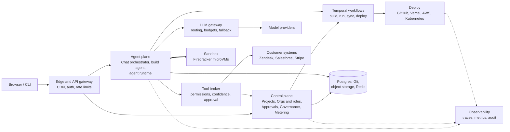

# Architect 2.0 — High-Level Design

This is the target production architecture. The repository today is a UI/UX prototype; only authentication is implemented for real. How the services work together is described in [SERVICES-SUMMARY.md](./SERVICES-SUMMARY.md).

## How to read it

1. **Everything enters through the gateway.** It checks the session once and passes a short-lived identity to every service behind it.
2. **Two planes do the work.** The control plane holds business rules: who owns what, who may approve, what a run costs. The agent plane turns prompts into apps and runs agents.
3. **Agents have two doors out.** Every model call goes through the LLM gateway; every action on a real system goes through the tool broker. That is where budgets, permissions, confidence checks and human approval are enforced, whatever framework the agent uses.
4. **Untrusted code is isolated.** Generated code runs only inside sandbox microVMs (thick arrow).
5. **Long work is durable.** Builds, agent runs, GitHub sync and deploys run as Temporal workflows, so they survive crashes and can wait days for an approval.
6. **Deploys are gated.** A release needs a passing governance score and evaluation, then rolls out gradually with automatic rollback.
7. **One trace id** follows each request end to end, which answers "why did the agent do that?".

Solid arrows are synchronous requests, dotted arrows are asynchronous events, and the thick arrow crosses an isolation boundary.
