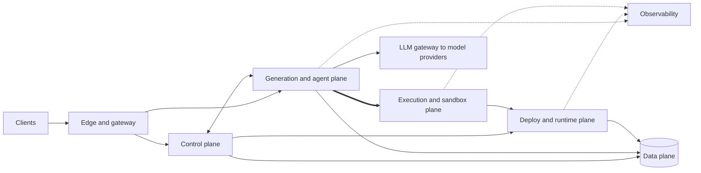
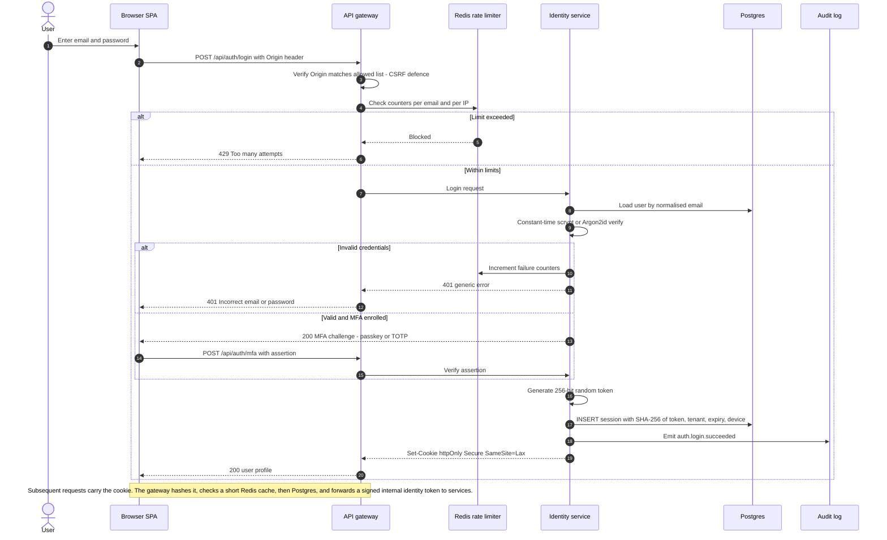
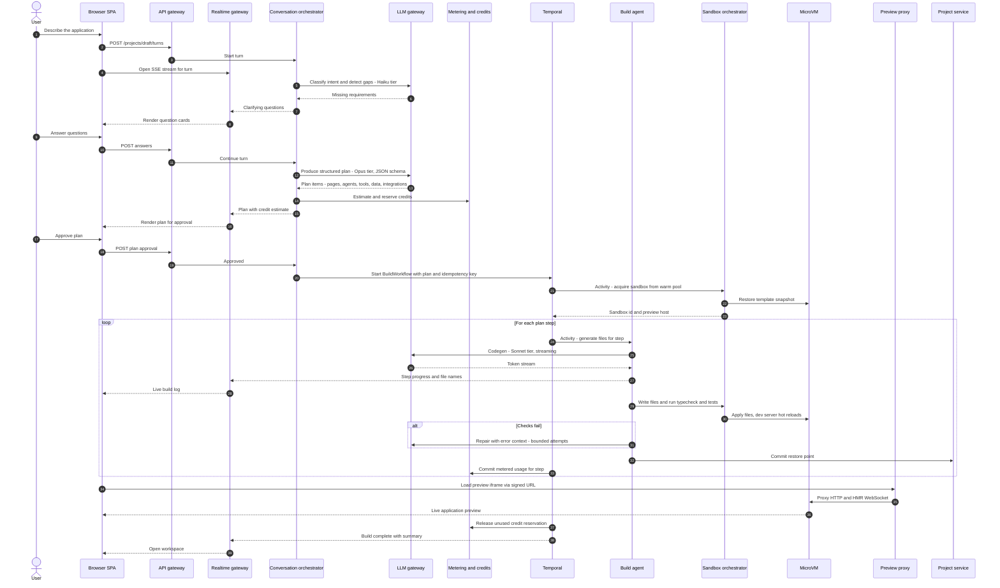
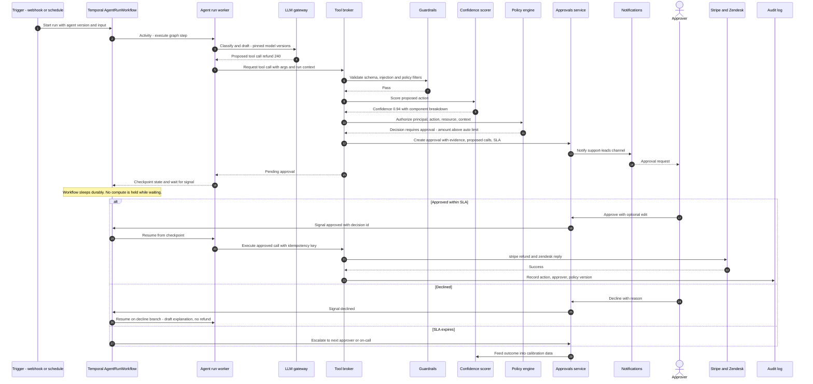
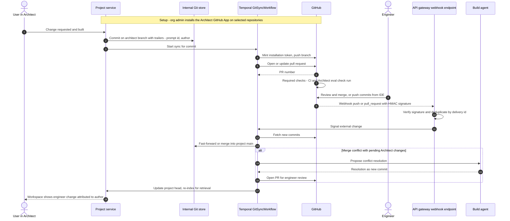
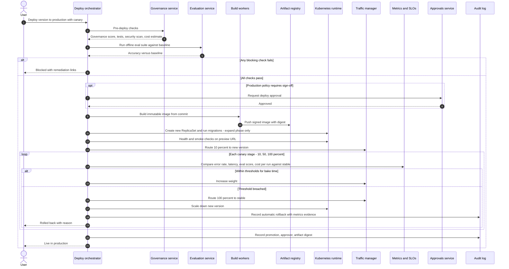

# Architect 2.0 — Architecture Diagrams

This document contains the diagrams for the **target production architecture** of Architect 2.0. The rationale behind each component is in [ARCHITECTURE.md](./ARCHITECTURE.md); how the services work together is described in [SERVICES-SUMMARY.md](./SERVICES-SUMMARY.md).

> **Scope note.** The repository today is a UI/UX prototype. Only authentication (Identity service, simplified) is implemented for real. Every other box below is the proposed production design. See [Prototype vs production](./ARCHITECTURE.md#11-prototype-vs-production).

All diagrams use Mermaid and render on GitHub.

---

## Legend

| Notation | Meaning |
|---|---|
| Rectangle | Stateless or horizontally scalable service |
| Cylinder | Durable data store |
| Double-bordered rectangle | Event bus / log |
| Solid arrow `-->` | Synchronous request (HTTPS, gRPC) |
| Dotted arrow `-.->` | Asynchronous event, stream or callback (Kafka, SSE, WebSocket, webhook) |
| Thick arrow `==>` | Untrusted or customer-supplied code / traffic crossing an isolation boundary |
| Edge label | Protocol and purpose |
| Colour band | Plane: clients (grey), edge (blue), control (purple), generation/agent (green), execution (red), data (amber), deploy/runtime (teal), observability (slate), external (white) |

Abbreviations: **BFF** backend-for-frontend, **RLS** Postgres row-level security, **OTLP** OpenTelemetry protocol, **HITL** human in the loop, **OCI** Open Container Initiative image format.

---

## 1. Top-level system diagram

```mermaid
flowchart TB
  subgraph CL["1 Clients"]
    WEB["Web app - React SPA<br/>business and developer modes"]
    CLI["CLI and IDE extension"]
    PUB["Public API consumers"]
  end

  subgraph EDGE["2 Edge and gateway"]
    CDN["CDN and WAF"]
    APIGW["API gateway and BFF<br/>session check, rate limits, routing"]
    RTG["Realtime gateway<br/>SSE and WebSocket fan-out"]
    PVP["Preview proxy<br/>signed per-sandbox preview URLs"]
  end

  subgraph CP["3 Control plane"]
    IDN["Identity service<br/>accounts, sessions, MFA, SSO roadmap"]
    ORG["Org, tenant and RBAC service"]
    PRJ["Project service<br/>projects, versions, restore points"]
    APR["Approvals service<br/>HITL inbox, SLAs, escalation"]
    POL["Policy engine - Cedar<br/>allowed, approval, blocked"]
    GOV["Governance service<br/>readiness checklist and gate"]
    INT["Integrations service<br/>connectors, OAuth tokens, MCP registry"]
    BIL["Metering, credits and billing"]
    MKT["Marketplace and templates"]
    NTF["Notification service"]
    AUD["Audit log service<br/>append-only, hash-chained"]
  end

  subgraph GP["4 Generation and agent plane"]
    CONV["Conversation orchestrator<br/>chat, clarify, plan"]
    GEN["Build agent<br/>codegen, repair, explain"]
    WFE["Durable workflow engine - Temporal"]
    AREG["Agent registry and framework adapters"]
    ARW["Agent run workers"]
    TBK["Tool broker and MCP host"]
    GRD["Guardrails service"]
    CONF["Confidence scorer"]
    EVS["Evaluation service"]
    LLMGW["LLM gateway<br/>routing, fallback, caching, budgets"]
    IDX["Retrieval and indexing service"]
  end

  subgraph EX["5 Execution and sandbox plane"]
    SBO["Sandbox orchestrator"]
    VMP["MicroVM pool - Firecracker<br/>dev servers, tests, tool code"]
    BLD["Build workers - in microVMs"]
  end

  subgraph DP["6 Data plane"]
    PG[("Postgres<br/>control and run state, RLS")]
    GIT[("Project source store<br/>internal Git")]
    OBJ[("Object storage<br/>snapshots, artifacts, uploads")]
    VEC[("Vector index - pgvector")]
    RDS[("Redis<br/>cache, rate limits, stream fan-out")]
    BUS[["Event bus - Kafka-compatible<br/>fed by transactional outbox"]]
    VLT[("Secrets vault and KMS<br/>per-tenant keys")]
  end

  subgraph DR["7 Deploy and runtime plane"]
    DEP["Deploy orchestrator"]
    REG[("OCI artifact registry")]
    K8S["Architect Cloud runtime<br/>Kubernetes, per-tenant namespaces"]
    TRM["Traffic manager<br/>weighted canary and blue-green"]
    TGA["Target adapters<br/>Vercel, customer AWS, container"]
    DNS["Domain and TLS manager"]
  end

  subgraph OB["8 Observability"]
    OTC["OpenTelemetry collectors"]
    CHS[("ClickHouse<br/>traces, logs, metering events")]
    MAL["Metrics, SLOs and alerting"]
  end

  subgraph EXT["9 External integrations"]
    LLMP["Model providers<br/>Anthropic, OpenAI, others, self-hosted"]
    GH["GitHub - GitHub App"]
    SAAS["Business SaaS<br/>Zendesk, Stripe, Slack, Salesforce, Jira"]
    MCPX["Customer MCP servers"]
    CCL["Customer cloud accounts"]
    VCL["Vercel"]
    PAY["Payment processor"]
    MSG["Email and chat delivery"]
  end

  %% Clients to edge
  WEB -->|"HTTPS"| CDN
  CDN -->|"HTTPS /api"| APIGW
  CLI -->|"HTTPS, scoped API token"| APIGW
  PUB -->|"HTTPS, API key"| APIGW
  WEB -.->|"SSE chat and build progress"| RTG
  WEB -.->|"iframe HTTPS and HMR WebSocket"| PVP

  %% Edge to control plane
  APIGW -->|"validate session"| IDN
  APIGW -->|"gRPC"| ORG
  APIGW -->|"gRPC"| PRJ
  APIGW -->|"gRPC"| APR
  APIGW -->|"gRPC"| GOV
  APIGW -->|"gRPC"| INT
  APIGW -->|"gRPC"| BIL
  APIGW -->|"gRPC"| MKT
  APIGW -->|"gRPC start chat turn"| CONV
  APIGW -->|"gRPC start deploy"| DEP
  RTG -.->|"subscribe per session"| RDS

  %% Control plane internals
  IDN -->|"SQL"| PG
  ORG -->|"SQL"| PG
  PRJ -->|"SQL"| PG
  PRJ -->|"commit, branch, tag"| GIT
  APR -->|"SQL"| PG
  APR -.->|"approval decided"| BUS
  APR -->|"notify approvers"| NTF
  NTF -->|"SMTP and chat APIs"| MSG
  GOV -->|"evaluate controls"| POL
  INT -->|"store tokens"| VLT
  BIL -->|"charges and invoices"| PAY
  BIL -.->|"consume usage events"| BUS
  AUD -.->|"consume all domain events"| BUS
  AUD -->|"WORM copy"| OBJ

  %% Generation plane
  CONV -->|"LLM calls"| LLMGW
  CONV -->|"start BuildWorkflow"| WFE
  CONV -.->|"token and step stream"| RDS
  WFE -->|"activities"| GEN
  WFE -->|"activities"| ARW
  WFE -->|"activities"| DEP
  WFE -->|"workflow history"| PG
  GEN -->|"LLM calls"| LLMGW
  GEN -->|"write files, run tests"| SBO
  GEN -->|"commit restore point"| PRJ
  GEN -->|"context retrieval"| IDX
  IDX -->|"embeddings"| LLMGW
  IDX -->|"vectors"| VEC
  ARW -->|"load agent version"| AREG
  AREG -->|"agent manifests"| PG
  ARW -->|"LLM calls"| LLMGW
  ARW -->|"tool calls"| TBK
  ARW -->|"checkpoints"| PG
  TBK -->|"authorize action"| POL
  TBK -->|"score"| CONF
  TBK -->|"input and output checks"| GRD
  TBK -->|"request approval"| APR
  TBK -->|"fetch scoped credential"| VLT
  TBK -->|"HTTPS"| SAAS
  TBK -->|"MCP"| MCPX
  TBK ==>|"run tool code"| SBO
  GRD -->|"classifier calls"| LLMGW
  CONF -->|"judge and sampling calls"| LLMGW
  EVS -->|"replay datasets"| WFE
  EVS -->|"results"| CHS
  LLMGW -->|"HTTPS, provider APIs"| LLMP
  LLMGW -->|"budget counters and cache"| RDS
  LLMGW -.->|"usage events"| BUS

  %% Execution plane
  SBO ==>|"create, snapshot, resume"| VMP
  SBO ==>|"build jobs"| BLD
  SBO -->|"snapshots"| OBJ
  PVP ==>|"route by signed host"| VMP
  BLD -->|"push image"| REG
  BLD -->|"build logs"| OTC

  %% Deploy plane
  DEP -->|"pre-deploy gate"| GOV
  DEP -->|"eval gate"| EVS
  DEP -->|"pull image"| REG
  DEP -->|"apply manifests"| K8S
  DEP -->|"set weights"| TRM
  DEP -->|"provision and deploy"| TGA
  DEP -->|"certificates and DNS"| DNS
  TGA -->|"Terraform, cloud APIs"| CCL
  TGA -->|"deployments API"| VCL
  TRM -->|"route traffic"| K8S

  %% GitHub
  PRJ -->|"push, open PR, installation token"| GH
  GH -.->|"webhooks push, PR, checks"| APIGW

  %% Observability
  ARW -.->|"OTLP spans"| OTC
  GEN -.->|"OTLP spans"| OTC
  K8S -.->|"OTLP spans, logs, metrics"| OTC
  LLMGW -.->|"OTLP spans"| OTC
  TBK -.->|"OTLP spans"| OTC
  OTC -->|"PII-redacted batch insert"| CHS
  OTC -->|"metrics"| MAL
  MAL -.->|"SLO burn, error-rate alerts"| DEP
  MAL -.->|"alerts"| NTF
  EVS -.->|"online eval sampling"| CHS

  classDef client fill:#eef0f3,stroke:#6b7280,color:#111
  classDef edge fill:#e0ecff,stroke:#2563eb,color:#111
  classDef control fill:#efe7ff,stroke:#7c3aed,color:#111
  classDef gen fill:#e3f7e8,stroke:#16a34a,color:#111
  classDef exec fill:#fde4e4,stroke:#dc2626,color:#111
  classDef data fill:#fff3d6,stroke:#d97706,color:#111
  classDef deploy fill:#dcf5f2,stroke:#0d9488,color:#111
  classDef obs fill:#e7ebf0,stroke:#475569,color:#111
  classDef ext fill:#ffffff,stroke:#9ca3af,color:#111

  class WEB,CLI,PUB client
  class CDN,APIGW,RTG,PVP edge
  class IDN,ORG,PRJ,APR,POL,GOV,INT,BIL,MKT,NTF,AUD control
  class CONV,GEN,WFE,AREG,ARW,TBK,GRD,CONF,EVS,LLMGW,IDX gen
  class SBO,VMP,BLD exec
  class PG,GIT,OBJ,VEC,RDS,BUS,VLT data
  class DEP,REG,K8S,TRM,TGA,DNS deploy
  class OTC,CHS,MAL obs
  class LLMP,GH,SAAS,MCPX,CCL,VCL,PAY,MSG ext
```

### Reading the diagram

- **Every request enters through the edge.** The API gateway validates the session with the Identity service once and forwards a short-lived signed internal identity (tenant, user, roles) to downstream services. No service behind the gateway reads the browser cookie.
- **Untrusted code only runs in the execution plane.** Thick arrows mark the only paths by which generated or customer-supplied code is executed: the sandbox orchestrator, build workers and the preview proxy.
- **All model traffic passes through the LLM gateway.** No service calls a model provider directly; this is where routing, fallback, caching, budgets and usage metering are enforced.
- **All agent side-effects pass through the tool broker.** It is the single enforcement point for permissions (policy engine), confidence thresholds, guardrails and human approval.
- **Long-running work is a Temporal workflow.** Builds, agent runs, GitHub sync and deploys survive process restarts and resume from their last completed step.

### Plane-level summary

---

## 2. Sequence: sign-in

The production flow keeps the prototype's model (opaque session token, stored only as a SHA-256 hash, httpOnly cookie) and adds distributed rate limiting, CSRF protection, MFA and an optional SSO path.

**SSO variant (roadmap).** For enterprise tenants the Identity service acts as an OIDC or SAML relying party: the user is redirected to the customer identity provider, the assertion is validated, the user is just-in-time provisioned into the tenant, and the same session cookie is issued. SCIM provisioning would keep membership in sync.

---

## 3. Sequence: prompt, clarify, plan, build with live preview

---

## 4. Sequence: agent run with human approval

Example from the prototype: a support agent proposes a refund of 240 dollars; the policy auto-approves up to 100 and blocks above 1,000.

---

## 5. Sequence: GitHub two-way sync

---

## 6. Sequence: deploy with governance gate, canary and automatic rollback

Blue-green follows the same gate, then switches 100 percent of traffic at once while keeping the previous environment warm for instant reversal. Instant deploys skip staged weights but retain the post-deploy watch and automatic rollback.
